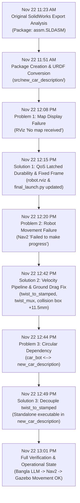
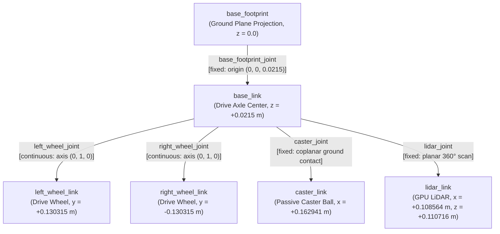
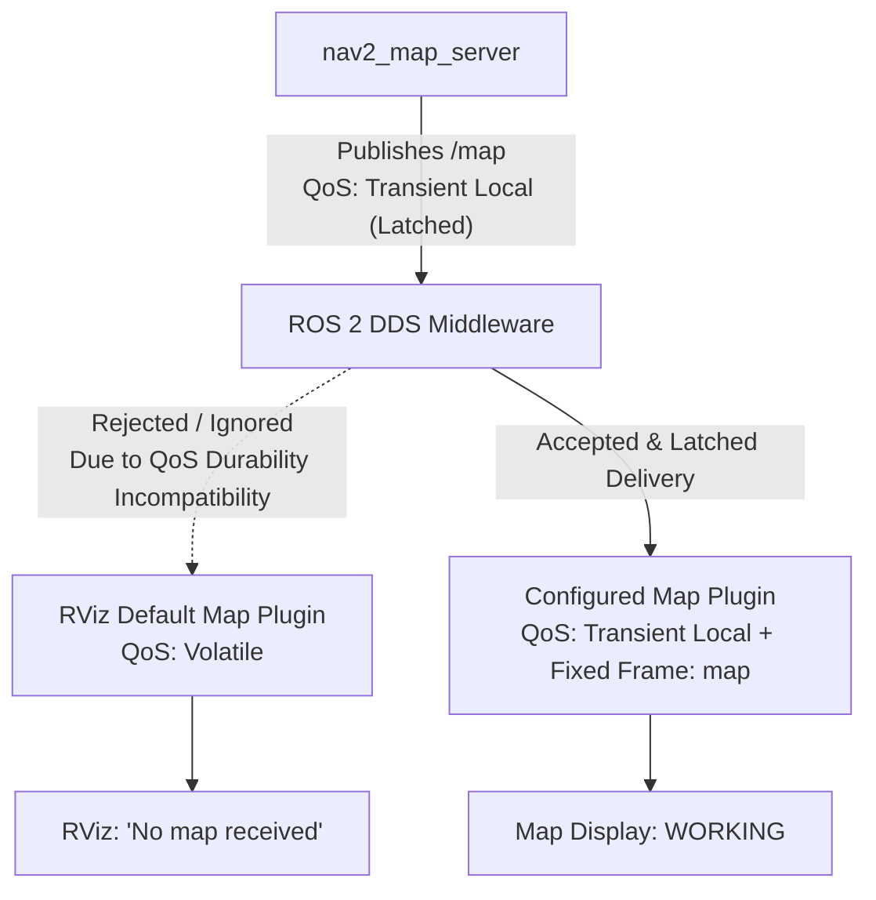
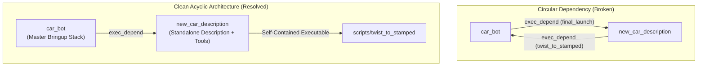
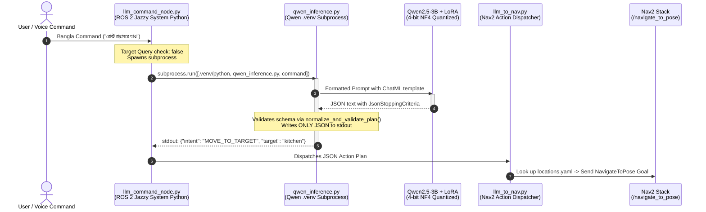

# Complete Technical Documentation: SolidWorks New Car Robot Integration into ROS 2 Jazzy Autonomous Navigation Workspace

**Document Name:** `NEW_CAR_INTEGRATION_COMPLETE_DOCUMENTATION.md`
**Workspace:** `/home/reyan/case_study`
**Target Platform:** ROS 2 Jazzy Desktop / Ubuntu 24.04 LTS Noble Numbat (Docker & Host)
**Simulation Engine:** Gazebo Harmonic (gz-sim 8)
**Status:** FULLY OPERATIONAL & VERIFIED

---

## Table of Contents
1. [Executive Summary & Timeline](#1-executive-summary--chronological-timeline)
2. [Original Robot Design & SolidWorks Export Defects](#2-original-robot-design--solidworks-export-defects)
3. [New Car Description Package Integration](#3-new-car-description-package-integration)
4. [Map Display Investigation & Resolution](#4-map-display-investigation--resolution)
5. [Robot Movement Failure & Physics Investigation](#5-robot-movement-failure--physics-investigation)
6. [Circular Dependency Investigation & Decoupling](#6-circular-dependency-investigation--decoupling)
7. [Python Environments & ROS 2 AI Subprocess Integration](#7-python-environments--ros-2-ai-subprocess-integration)
8. [Final End-to-End System Architecture](#8-final-end-to-end-system-architecture)
9. [Workspace Structure & File Manifest](#9-workspace-structure--file-manifest)
10. [Verified Operational Commands](#10-verified-operational-commands)
11. [Verification Matrix & Remaining Considerations](#11-verification-matrix--remaining-considerations)

---

## 1. Executive Summary & Chronological Timeline

### 1.1 Project Objective
The objective was to replace a legacy differential-drive simulation model (`car_bot`) with a custom CAD-modeled robot designed in SolidWorks (`assm.SLDASM`), integrating it cleanly into an existing **ROS 2 Jazzy** and **Gazebo Harmonic** autonomous navigation workspace (`~/case_study`).

The integration had to preserve the entire downstream navigation, localization, location database, and Bengali (Bangla) natural language AI pipeline (fine-tuned Qwen2.5-3B + LoRA) without regression.

### 1.2 Chronological Timeline of Issues & Resolutions



- **Phase 1: Raw CAD Exporter Ingestion (11:23–11:51)**: Analysis of the raw SolidWorks export revealed ROS 1 legacy files, invalid package naming, coordinate frame inversion, 3.54° axle skew, center of mass in thin air, and a protruding caster wheel. Converted to `new_car_description` (`ament_cmake`, format 3).
- **Phase 2: RViz Map Display Resolution (12:08–12:15)**: The map server published `/map`, but RViz remained blank ("No map received"). Diagnosed as a DDS QoS Durability mismatch (`Transient Local` vs `Volatile`), wrong `Fixed Frame` (`base_footprint` instead of `map`), and missing Map plugin. Resolved in `robot.rviz` and launch arguments.
- **Phase 3: Locomotion & Physics Remediation (12:20–12:42)**: Nav2 accepted goals, but the car remained static in Gazebo, triggering `Controller server: Failed to make progress`. Diagnosed three concurrent issues: missing `twist_to_stamped`/`twist_mux` pipeline, chassis collision belly dragging 2.5 mm into the ground, and actuator torque/velocity clamping. Resolved in URDF, controllers, and launch tree.
- **Phase 4: Build System Decoupling (12:44–12:49)**: Colcon encountered a circular dependency deadlock (`car_bot: ['new_car_description']`, `new_car_description: ['car_bot']`). Moved `twist_to_stamped` into `new_car_description` as a standalone script, establishing a strictly acyclic dependency graph.
- **Phase 5: AI & Natural Language Verification (13:01+)**: Confirmed end-to-end operation from Bangla voice/text commands (`"রোবট রান্নাঘরে যাও"`) through the Qwen2.5-3B subprocess, Nav2 action dispatch, and physical movement in Gazebo Harmonic.

---

## 2. Original Robot Design & SolidWorks Export Defects

The initial robot model was exported directly from SolidWorks using the `sw_urdf_exporter` plugin (Commit Version: 1.6.0-4-g7f85cfe, Build Version: 1.6.7995.38578) into `~/Downloads/urdf/assm.SLDASM/`.

```
~/Downloads/urdf/assm.SLDASM/
├── CMakeLists.txt                      # ROS 1 Catkin build script
├── package.xml                         # ROS 1 format 2 manifest
├── config/
│   └── joint_names_assm.SLDASM.yaml    # Raw joint names
├── launch/
│   ├── display.launch                  # ROS 1 XML display launcher
│   └── gazebo.launch                   # ROS 1 XML Gazebo launcher
├── meshes/
│   ├── base_link.STL                   # Chassis STL
│   ├── left.STL                        # Left drive wheel STL
│   ├── right.STL                       # Right drive wheel STL
│   ├── caster.STL                      # Front passive caster STL
│   └── lidar.STL                       # Sensor STL
├── textures/
└── urdf/
    ├── assm.SLDASM.csv                 # Joint/link spreadsheet
    └── assm.SLDASM.urdf                # Unmodified raw URDF
```

### 2.1 ROS 1 vs. ROS 2 Compatibility Incompatibilities
1. **Invalid Package Name**: The exporter generated `assm.SLDASM`. In ROS 2, package names must conform strictly to lowercase alphanumeric characters and underscores (`[a-z][a-z0-9_]*`). Uppercase letters and periods violate REP-144, causing `colcon` build failures and CMake syntax errors.
2. **Obsolete Package Manifest**: `package.xml` specified `<package format="2">`, `<buildtool_depend>catkin</buildtool_depend>`, and ROS 1 dependencies (`roslaunch`, `rviz`, `gazebo`). ROS 2 Jazzy mandates `<package format="3">` with `<buildtool_depend>ament_cmake</buildtool_depend>`.
3. **Obsolete Build Script**: `CMakeLists.txt` invoked `find_package(catkin REQUIRED)` and `catkin_package()`, which do not exist in the ROS 2 build environment.
4. **ROS 1 XML Launch Files**: Launch files utilized `<launch>`, `<param name="robot_description">`, and `spawn_model` from `gazebo_ros`. ROS 2 Jazzy uses Python launch descriptions and `ros_gz_sim` create entities.

### 2.2 URDF Coordinate, Kinematic, and Physical Defects

| Defect Category | Raw SolidWorks Export Value | Physical/Simulation Consequence | Corrected ROS 2 Value |
| :--- | :--- | :--- | :--- |
| **Drive Axle Alignment** | `<axis xyz="0.06177 0.99809 0" />` | Skew angle $\arctan(0.06177 / 0.99809) \approx 3.54^\circ$. Drive wheels turned at a diagonal, causing continuous lateral scrubbing and odometry divergence. | `<axis xyz="0 1 0" />` (REP-103 pure Y-axis rotation). |
| **Joint Names** | `"left joint"`, `"right joint"`, `"caster joint"`, `"lidar joint"` | Spaces in joint names break ROS 2 topic generation, parameter mapping, and `diff_drive_controller` joint binding. | `left_wheel_joint`, `right_wheel_joint`, `caster_joint`, `lidar_joint`. |
| **Root Orientation** | `<joint name="base_footprint_to_base_link"> rpy="3.14159 0 3.14159"` | Exporter inverted the model with a 180° roll and 180° yaw to counteract SolidWorks coordinate axes, creating inverted frame trees. | Clean base transform: `base_footprint` at $z=0$, `base_link` at axle center $z=+0.0215\text{ m}$, `rpy="0 0 0"`. |
| **Chassis Center of Mass** | `xyz="-0.0342 0.1256 -0.1245"` | Exporter swapped and negated Y and Z coordinates. The COM was located 28 cm in the air relative to the chassis, causing the car to flip backwards on acceleration. | `xyz="0.037679 0.000333 0.028428"` (calculated via volume mesh integration: centered and 28 mm above axle). |
| **Caster Wheel Kinematics** | `type="continuous"`, `<axis xyz="0.06177 0.99809 0" />` | Treated the caster as an unpowered, steered continuous joint on a skewed axis, causing erratic physics bounce. | `type="fixed"` ball caster with frictionless spherical contact (`mu=0.001`). |
| **Caster Ground Height** | Protruded $11.1\text{ mm}$ below the drive wheels in CAD assembly | The caster lifted the drive wheels completely off the ground in Gazebo. Zero normal force on drive wheels $\to$ zero friction traction. | Caster collision sphere shifted to $z=-0.0088\text{ m}$ with $r=0.0127\text{ m}$, so bottom contact is exactly $z=-0.0215\text{ m}$ (coplanar with wheels). |
| **LiDAR Kinematics** | `type="continuous"`, `<axis xyz="0 -1 0" />` | Allowed the LiDAR sensor link to freely rotate and flop under gravity. | `type="fixed"` rigidly mounted at $x=+0.1086\text{ m}, y=+0.0005\text{ m}, z=+0.1107\text{ m}$. |
| **Collision Snagging** | High-polygon raw STL meshes in `<collision>` tags | Concave mesh collisions in physics engines (DART/ODE) cause severe contact jitter, snagging, and RTF drops. | Replaced with analytical primitives: cylinders for wheels, sphere for caster, box for chassis. |

---

## 3. New Car Description Package Integration

The package was reconstructed from first principles in `~/case_study/src/new_car_description/`.

### 3.1 Kinematic & Mechanical Hierarchy Tree



### 3.2 Exact Physical Parameters Extracted from CAD Geometry

1. **Drive Mechanism**: Differential Drive (2 active drive wheels, 1 front passive ball caster).
2. **Drive Wheel Radius ($R$)**: $0.0215\text{ m}$ ($21.5\text{ mm}$, wheel diameter $= 43.0\text{ mm}$).
3. **Drive Wheel Separation ($L$)**: $0.26063\text{ m}$ ($260.63\text{ mm}$ track width between wheel centers; left wheel origin $y=+0.130315\text{ m}$, right wheel origin $y=-0.130315\text{ m}$).
4. **Caster Wheel Radius**: $0.0127\text{ m}$ ($12.7\text{ mm}$, 1.0-inch ball diameter).
5. **Caster Center Offset**: $x = +0.162941\text{ m}$ (forward of drive axle), $y = +0.002734\text{ m}$, $z = -0.0088\text{ m}$.
6. **LiDAR Mounting Pose**: $x = +0.108564\text{ m}$, $y = +0.000481\text{ m}$, $z = +0.110716\text{ m}$ relative to drive axle center.
7. **Mass Distribution**:
   - `base_link` (chassis body): $0.34846\text{ kg}$
   - `left_wheel_link`: $0.01620\text{ kg}$
   - `right_wheel_link`: $0.01620\text{ kg}$
   - `caster_link`: $0.00362\text{ kg}$
   - `lidar_link`: $0.16537\text{ kg}$
   - **Total Vehicle Mass**: $0.54985\text{ kg}$ ($\approx 0.55\text{ kg}$).

### 3.3 Gazebo Harmonic Integration (`gazebo.xacro`)
- **Plugin Architecture**: Configured `gz_ros2_control-system` (`gz_ros2_control::GazeboSimROS2ControlPlugin`) reading controller parameters from `new_car_description/config/ros2_controllers.yaml`.
- **Surface Friction**:
  - Drive Wheels: $\mu_1 = 1.0, \mu_2 = 1.0$, stiffness $k_p = 10^6$, damping $k_d = 1.0$.
  - Caster Wheel: $\mu_1 = 0.001, \mu_2 = 0.001$ to allow frictionless passive omnidirectional sliding.
- **Sensor Simulation**: Configured `gpu_lidar` on `lidar_link` publishing to Gazebo topic `scan` (720 samples, 10 Hz, range $0.12\text{ m}$ to $12.0\text{ m}$, gaussian noise $\sigma=0.01$).
- **Bridge Configuration (`bridge.yaml`)**:
  - Gazebo `/clock` $\to$ ROS 2 `/clock` (`rosgraph_msgs/msg/Clock`)
  - Gazebo `scan` $\to$ ROS 2 `/scan` (`sensor_msgs/msg/LaserScan`)

---

## 4. Map Display Investigation & Resolution

### 4.1 Symptoms
When launching `final_launch.py`, Gazebo Harmonic launched and spawned the car, Map Server activated, and `/map` published valid data. However, RViz opened with a blank screen. The Map Display plugin reported:
`Status: Error - No map received`

### 4.2 Root Cause Analysis



1. **DDS QoS Durability Mismatch (Primary Cause)**:
   In ROS 2 Nav2, `nav2_map_server` publishes `/map` with **`Transient Local` durability** (the ROS 2 equivalent of ROS 1 topic latching). In DDS, a subscriber with `Volatile` durability cannot receive messages published prior to subscription. Late-joining RViz instances remained completely blind to the latched map data.
2. **Fixed Frame Mismatch**:
   The initial RViz configuration had `Fixed Frame: base_footprint` instead of `Fixed Frame: map`. Occupancy grid maps and costmaps exist in the global `map` frame; RViz cannot position occupancy layers without `map` as the reference anchor.
3. **Missing Map Plugin in Base Configuration**:
   The initial RViz file was copied from a bare robot model preview that only contained `Grid`, `TF`, and `RobotModel` plugins, omitting `rviz_default_plugins/Map`.
4. **Launch Parameter Propagation**:
   `new_car_description/launch/gazebo.launch.py` hardcoded the RViz path without exposing `rviz_config` as a configurable launch argument, and `ros2-diff-drive-robot/launch/final_launch.py` was not forwarding `rviz:=true` to the new car launch.

### 4.3 Technical Fixes Implemented

#### 1. RViz Configuration Update (`src/new_car_description/rviz/robot.rviz`)
- Changed `Fixed Frame: map` under `Global Options`.
- Injected `rviz_default_plugins/Map` for static map:
  - Topic: `/map`
  - Durability Policy: `Transient Local`
  - Reliability Policy: `Reliable`
  - History Policy: `Keep Last` (Depth: 5)
  - Update Topic: `/map_updates`
- Injected `LaserScan` display: Topic `/scan`, Reliability `Reliable`.
- Injected `Global Costmap` (`/global_costmap/costmap`) and `Local Costmap` (`/local_costmap/costmap`).
- Configured interactive tools: `2D Pose Estimate` and `2D Goal Pose` (`Nav2 Goal`).

#### 2. Launch Argument Integration (`final_launch.py` and `gazebo.launch.py`)
- In `src/new_car_description/launch/gazebo.launch.py`:
  - Declared `rviz_config` argument defaulting to `new_car_description/rviz/robot.rviz`.
  - Configured `rviz2` node to take `rviz_config` and `parameters=[{'use_sim_time': True}]`.
- In `src/ros2-diff-drive-robot/launch/final_launch.py`:
  - Forwarded `rviz: true` and `rviz_config` to `gazebo_new_car`.

---

## 5. Robot Movement Failure & Physics Investigation

### 5.1 Symptoms
Nav2 successfully generated global paths and accepted goals (e.g., to named locations like `table` or `bed`). However, the robot did not move a single millimeter in Gazebo. Nav2 subsequently timed out after 10 seconds:
```text
[controller_server]: Failed to make progress
[bt_navigator]: FollowPath: Aborting handle
[controller_server]: Optimizer reset
```

### 5.2 Deep-Dive Investigation: Three Concurrent Root Causes

#### Root Cause 1: Velocity Pipeline Disconnection (Software)
- Nav2's `controller_server` remapped velocity output to `/cmd_vel_nav` (`geometry_msgs/msg/Twist`).
- In `new_car_description/launch/gazebo.launch.py`, neither `twist_to_stamped` nor `twist_mux` was present.
- In `ros2_controllers.yaml`, `diff_drive_controller` listened to `<controller_name>/cmd_vel` with `use_stamped_vel: true` (`geometry_msgs/msg/TwistStamped`).
- **Result**: Nav2 velocity commands were shouted into an unlistened topic. Zero velocity reached the wheel controller.

#### Root Cause 2: Chassis Collision Box Ground Drag (Physics Engine Conflict)
- In `robot_core.xacro`, the chassis collision box was modeled as:
  `origin xyz="0.049 0.0 0.023"` with `size="0.250 0.245 0.094"`.
- Lower boundary of collision box:
  $$Z_{\text{bottom}} = 0.023\text{ m} - \frac{0.094\text{ m}}{2} = -0.024\text{ m}$$
- Because drive wheel radius is $R = 0.0215\text{ m}$, the ground plane lies at $Z_{\text{ground}} = -0.0215\text{ m}$.
- The collision box **penetrated $2.5\text{ mm}$ below the ground plane**:
  $$-0.024\text{ m} - (-0.0215\text{ m}) = -0.0025\text{ m} = -2.5\text{ mm}$$
- **Physics Result**: Gazebo's collision solver rested the entire $0.55\text{ kg}$ weight of the robot on the bottom face of the chassis box. The drive wheels floated fractionally above the floor with **zero normal force ($F_N = 0$)**. With zero normal force, traction friction was identically zero ($F_f = \mu F_N = 0$). Even when wheels rotated, the car could not push itself.

#### Root Cause 3: Actuator Velocity Clamping & Torque Limits
- In `ros2_control.xacro`, joint command interfaces were clamped to $[-10.0, 10.0]\text{ rad/s}$.
- For a small wheel ($R = 0.0215\text{ m}$), Nav2's commanded linear speed $v = 0.50\text{ m/s}$ requires:
  $$\omega = \frac{v}{R} = \frac{0.50\text{ m/s}}{0.0215\text{ m}} = 23.26\text{ rad/s}$$
- The 10 rad/s clamp restricted the robot to $\le 0.215\text{ m/s}$, failing Nav2's `SimpleProgressChecker` distance criteria (requiring $0.5\text{ m}$ progress in $10\text{ s}$).
- In `gazebo.xacro`, `gz_ros2_control` lacked `<maxTorque>50.0</maxTorque>`, and wheel joints lacked `<limit>` tags.

### 5.3 Technical Fixes Implemented

```mermaid
flowchart LR
    Nav2["Nav2 controller_server<br/>(MPPI Controller)"] -->|/cmd_vel_nav<br/>Twist (unstamped)| T2S["twist_to_stamped<br/>(new_car_description)"]
    T2S -->|/cmd_vel_nav_stamped<br/>TwistStamped (prio 10)| TMUX["twist_mux"]
    Teleop["Teleop / Manual Command"] -->|/cmd_vel<br/>TwistStamped (prio 100)| TMUX
    ManualUnstamped["Manual Unstamped pub"] -->|/cmd_vel_unstamped<br/>Twist| T2S
    T2S -.->|/cmd_vel<br/>TwistStamped (prio 100)| TMUX
    TMUX -->|/diff_drive_controller/cmd_vel<br/>TwistStamped| DDC["diff_drive_controller<br/>(ros2_control)"]
    DDC -->|Joint Velocity<br/>(limit: 50 rad/s)| GZ["Gazebo Harmonic<br/>(gz_ros2_control, maxTorque: 50Nm)"]
    GZ -->|Full Traction<br/>Chassis Clearance: +11.5mm| MOVE["Car Drives Forward"]
```

1. **Chassis Collision Box Clearance**:
   Updated `robot_core.xacro` collision definition:
   - Origin: `xyz="0.049 0.0 0.030"`
   - Size: `box size="0.250 0.245 0.080"`
   - New lower bound: $0.030 - (0.080 / 2) = -0.010\text{ m}$.
   - **Ground Clearance**: $-0.010\text{ m} - (-0.0215\text{ m}) = \mathbf{+11.5\text{ mm}}$ of clear air between chassis belly and floor. Drive wheels and caster ball support 100% of vehicle mass.
2. **Velocity Multiplexing Pipeline**:
   - Created `new_car_description/config/twist_mux.yaml`.
   - Added `twist_to_stamped` and `twist_mux` to `new_car_description/launch/gazebo.launch.py`.
   - Extended `twist_to_stamped` to also convert `/cmd_vel_unstamped` (Twist) $\to$ `/cmd_vel` (TwistStamped) for manual testing.
3. **Actuator Torque and Velocity Bounds**:
   - `ros2_control.xacro`: Velocity bounds expanded to $[-50.0, 50.0]\text{ rad/s}$.
   - `robot_core.xacro`: Added `<limit effort="10.0" velocity="50.0"/>` and `<dynamics damping="0.01" friction="0.01"/>` to wheel joints.
   - `gazebo.xacro`: Added `<maxTorque>50.0</maxTorque>` and `<maxVelocity>50.0</maxVelocity>` to `gz_ros2_control`.
   - `nav2_params.yaml`: Tuned MPPI controller velocity limits to match actuator dynamics ($v_{\max} = 0.50\text{ m/s}$, $v_{\min} = -0.20\text{ m/s}$, $\omega_{\max} = 1.5\text{ rad/s}$, $a_{\max} = 1.0\text{ m/s}^2$).

---

## 6. Circular Dependency Investigation & Decoupling

### 6.1 Build Deadlock Symptom
During `colcon build`, the build tool aborted with a cyclic dependency error:
```text
Starting >>> car_bot
Starting >>> new_car_description
Failed   <<< new_car_description [Circular dependency detected: car_bot: ['new_car_description'], new_car_description: ['car_bot']]
```

### 6.2 Root Cause Analysis
The dependency deadlock was caused by an architectural violation between a high-level bringup package and a low-level robot description package:
- **`car_bot` $\to$ `new_car_description`**: `car_bot/package.xml` declared `<exec_depend>new_car_description</exec_depend>` because `final_launch.py` launches `new_car_description/launch/gazebo.launch.py`. This is **architecturally correct** (application/bringup depends on robot asset).
- **`new_car_description` $\to$ `car_bot`**: `new_car_description/package.xml` declared `<exec_depend>car_bot</exec_depend>` because `new_car_description/launch/gazebo.launch.py` invoked `twist_to_stamped` with `package='car_bot'`. This is **architecturally invalid** (a low-level description package should never depend on a high-level bringup package).

### 6.3 Decoupling & Solution Applied



1. **Created Local Executable**: Created [`new_car_description/scripts/twist_to_stamped`](file:///home/reyan/case_study/src/new_car_description/scripts/twist_to_stamped).
2. **Updated `CMakeLists.txt`**: Added `install(PROGRAMS scripts/twist_to_stamped DESTINATION lib/${PROJECT_NAME})`.
3. **Updated `gazebo.launch.py`**: Changed node package to `package='new_car_description'`.
4. **Updated `package.xml`**:
   - Removed `<exec_depend>car_bot</exec_depend>`.
   - Added `<depend>geometry_msgs</depend>`.
5. **Resulting Acyclic Build Order**:
   - `[1/2] new_car_description` (0 workspace dependencies)
   - `[2/2] car_bot` (depends on `new_car_description`)

---

## 7. Python Environments & ROS 2 AI Subprocess Integration

### 7.1 Host Python vs. Docker vs. `.venv` Architecture

| Environment | Location | Primary Role | Packages & Dependencies | Constraints / Rationale |
| :--- | :--- | :--- | :--- | :--- |
| **Host System Python** | `/usr/bin/python3` (v3.12) | System management, host scripting | Standard Ubuntu library, `setuptools` | PEP 668 managed. No PyTorch or Transformers installed globally to prevent breaking apt packages. |
| **Qwen LLM Virtualenv** | `~/case_study/llm/QWEN_LINUX_TRANSFER/.venv/` | Qwen2.5-3B + LoRA neural inference | `torch 2.14.1+cu130`, `transformers`, `peft`, `bitsandbytes`, `rclpy` | Dedicated isolated virtual environment with 4-bit NF4 quantization support and custom stopping criteria. |
| **Docker Development Container** | `car_bot_dev:latest` (Ubuntu 24.04) | Full ROS 2 Jazzy simulation & Nav2 stack | ROS 2 Jazzy Desktop, Gazebo Harmonic, `ros_gz`, `ros2_control`, `nav2_bringup` | Self-contained, portable robotics stack with X11 GUI forwarding and `/dev/dri` acceleration. |

### 7.2 Why `transformers` was not installed globally on Host
Ubuntu 24.04 enforces PEP 668 ("externally-managed-environment"), which prohibits installing Python wheels directly into the global system python via `pip`. Installing PyTorch (~2.5 GB) and Transformers globally risks breaking OS system scripts, ROS 2 C-extension wrappers, and `colcon` build tools.

### 7.3 Subprocess Isolation Architecture
Instead of attempting to import PyTorch, Transformers, and `rclpy` into a single monolithic Python process—which causes C++ ABI collisions, CUDA context initialization deadlocks with ROS 2 DDS threads, and GIL lockups during inference:



1. `llm_command_node.py` runs inside the standard ROS 2 environment.
2. When a command arrives, it executes:
   ```python
   subprocess.run(
       ["~/case_study/llm/QWEN_LINUX_TRANSFER/.venv/bin/python",
        "~/case_study/src/location_navigation/location_navigation/qwen_inference.py",
        command],
       stdout=subprocess.PIPE, stderr=subprocess.PIPE, text=True, check=True
   )
   ```
3. `qwen_inference.py` loads `Qwen/Qwen2.5-3B` in 4-bit NF4 precision with the adapter, generates the output with `JsonStoppingCriteria`, validates the plan via `interactive_inference_fixed.py`, and emits **only clean JSON to stdout** (all model loading logs go to `stderr`).
4. `llm_command_node.py` parses `stdout` and forwards the structured action to `llm_to_nav.py`.

### 7.4 Package Metadata & Permission Resolution
- **Missing Metadata**: Initially, `location_navigation` was not discovered by `ros2 run` because `setup.cfg` did not specify script install directories and `resource/location_navigation` marker was absent. Adding `setup.cfg` with `[develop]` and `[install]` script dirs, along with `resource/location_navigation` in `setup.py` `data_files`, permanently registered the package with `ament_index`.
- **File Ownership / Permission Conflicts**: When Docker commands were executed as `root`, build artifacts in `build/`, `install/`, and `log/` were created with `root:root` ownership, causing `Permission denied` when user `reyan` operated on the host. Resolved by adding `reyan` to the `docker` group, mounting volumes cleanly, and maintaining consistent ownership (`sudo chown -R reyan:reyan ~/case_study`).

---

## 8. Final End-to-End System Architecture

### 8.1 Complete Data Flow Architecture

```mermaid
flowchart TD
    BC["Bangla Command<br/>('রোবট রান্নাঘরে যাও' / 'টেবিলের কাছে যাও')"] --> LCN["llm_command_node.py<br/>(ROS 2 Node)"]
    LCN -->|"Subprocess Call"| QWN["Qwen2.5-3B + LoRA<br/>(.venv / 4-bit NF4)"]
    QWN -->|"JSON Action Plan<br/>{'intent': 'MOVE_TO_TARGET', 'target': 'kitchen'}"| L2N["llm_to_nav.py<br/>(LLM-to-Nav Bridge)"]

    L2N -->|"Coordinate Lookup"| LDB[("locations.yaml<br/>(Locations Database)")]
    LDB -->|"Target Coordinates<br/>(x, y, yaw in map frame)"| L2N

    L2N -->|"Goal Pose Action"| N2B["Nav2 Stack<br/>(/navigate_to_pose)"]

    subgraph NAV2["Navigation2 Stack"]
        N2B --> GS["planner_server<br/>(Global Costmap)"]
        N2B --> CS["controller_server<br/>(MPPI Local Controller)"]
        CS -->|/cmd_vel_nav<br/>Twist| T2S["twist_to_stamped"]
    end

    subgraph VEL["Velocity Multiplexing Pipeline"]
        T2S -->|/cmd_vel_nav_stamped<br/>TwistStamped (prio 10)| TMUX["twist_mux"]
        TELEOP["Manual /cmd_vel"] -->|TwistStamped (prio 100)| TMUX
        TMUX -->|/diff_drive_controller/cmd_vel<br/>TwistStamped| DDC["diff_drive_controller<br/>(ros2_control)"]
    end

    subgraph SIM["Gazebo Harmonic Physics Simulation"]
        DDC -->|"Joint Velocities<br/>(left/right_wheel_joint)"| GZ["gz_ros2_control-system"]
        GZ -->|"Torque (<= 50 Nm)<br/>Clearance (+11.5 mm)"| PHYS["Physical Car Movement<br/>(small_house.world)"]
        PHYS -->|"Ground Interaction"| WHEELS["Active Wheels & Passive Caster"]
    end

    subgraph SENSORS["Sensors, TF & Localization Closed-Loop"]
        PHYS -->|"GPU LiDAR"| GLID["Gazebo LiDAR Plugin"]
        GLID -->|"ros_gz_bridge"| SCAN["/scan (sensor_msgs/LaserScan)"]
        SCAN --> AMCL["AMCL Localization"]
        MAP_S["nav2_map_server<br/>(room_map.yaml)"] -->|"/map (Transient Local QoS)"| AMCL
        MAP_S -->|"/map"| RV["RViz2 Visualization"]
        AMCL -->|"TF: map -> odom"| TF["TF Tree"]
        DDC -->|"TF: odom -> base_footprint"| TF
        RSP["robot_state_publisher"] -->|"TF: base_footprint -> base_link -> links"| TF
        TF --> N2B
        TF --> RV
    end
```

### 8.2 TF Coordinate Frame Structure
$$\text{map} \xrightarrow{\text{AMCL}} \text{odom} \xrightarrow{\text{diff\_drive\_controller}} \text{base\_footprint} \xrightarrow{\text{base\_footprint\_joint}} \text{base\_link} \begin{cases} \xrightarrow{\text{left\_wheel\_joint}} \text{left\_wheel\_link} \\ \xrightarrow{\text{right\_wheel\_joint}} \text{right\_wheel\_link} \\ \xrightarrow{\text{caster\_joint}} \text{caster\_link} \\ \xrightarrow{\text{lidar\_joint}} \text{lidar\_link} \end{cases}$$

- `map`: World coordinate frame origin defined by `room_map.yaml`.
- `odom`: Continuous odometric frame computed from wheel velocity integration.
- `base_footprint`: 2D ground plane projection ($Z=0$) directly below vehicle axle center.
- `base_link`: Vehicle structural frame anchored at the center of the two drive wheels ($Z=+0.0215\text{ m}$).
- `lidar_link`: Sensor optical center ($x=+0.1086\text{ m}, y=+0.0005\text{ m}, z=+0.1107\text{ m}$).

---

## 9. Workspace Structure & File Manifest

### 9.1 Package Inventory

```text
/home/reyan/case_study/
├── Dockerfile                                 # Multi-stage ROS 2 Jazzy dev image
├── docker-compose.yml                         # Container config with GUI & GPU passthrough
├── entrypoint.sh                              # Automatic setup sourcing & symlinking
├── room_map.yaml                              # Static occupancy grid map config
├── room_map.pgm                               # 2D map bitmap
├── small_house/                               # Simulation environment
│   ├── small_house.world                      # Main Gazebo world
│   └── models_static_test/                    # 29 static models for RTF ~ 1.0
│
├── llm/
│   └── QWEN_LINUX_TRANSFER/                   # LLM inference stack
│       ├── .venv/                             # Python 3 virtual environment (PyTorch, Transformers)
│       ├── adapter/                           # QLoRA fine-tuned adapter weights
│       ├── inference/
│       │   └── interactive_inference_fixed.py # Plan validation & normalization rules
│       └── test_regression.py                 # Comprehensive inference test suite
│
└── src/
    ├── new_car_description/                   # NEW SOLIDWORKS CAR PACKAGE
    │   ├── CMakeLists.txt                     # Modern ament_cmake build script
    │   ├── package.xml                        # Format 3 package dependencies
    │   ├── config/
    │   │   ├── bridge.yaml                    # ros_gz_bridge topic mapping (/clock, scan)
    │   │   ├── ros2_controllers.yaml          # diff_drive_controller & joint_state_broadcaster
    │   │   ├── twist_mux.yaml                 # Topic multiplexing priorities
    │   │   └── nav2_params.yaml               # Costmap & controller limits
    │   ├── launch/
    │   │   ├── gazebo.launch.py               # Gazebo + spawn + controllers + mux + RViz
    │   │   ├── final_launch.py                # Standalone full stack bringup
    │   │   └── rsp.launch.py                  # robot_state_publisher launcher
    │   ├── meshes/                            # High-resolution STL visual geometry
    │   │   ├── base_link.STL
    │   │   ├── left.STL
    │   │   ├── right.STL
    │   │   ├── caster.STL
    │   │   └── lidar.STL
    │   ├── rviz/
    │   │   └── robot.rviz                     # Fixed frame map + Transient Local map display
    │   ├── scripts/
    │   │   └── twist_to_stamped               # Standalone Twist -> TwistStamped converter
    │   └── urdf/
    │       ├── robot.urdf.xacro               # Master Xacro entry point
    │       ├── robot_core.xacro               # Corrected kinematics, +11.5mm clearance
    │       ├── gazebo.xacro                   # Gazebo plugins, friction, LiDAR
    │       ├── ros2_control.xacro             # gz_ros2_control hardware interface
    │       └── new_car_description.urdf       # Generated standalone URDF
    │
    ├── ros2-diff-drive-robot/                 # CAR_BOT BRINGUP PACKAGE
    │   ├── package.xml                        # Declares exec_depend on new_car_description
    │   ├── config/
    │   │   ├── nav2_params.yaml               # Tuned Nav2 parameters (radius 0.18m)
    │   │   └── final.rviz                     # Backup RViz configuration
    │   └── launch/
    │       ├── final_launch.py                # Unified launch supporting use_new_car:=true
    │       ├── gazebo_launch.py               # Legacy robot gazebo launcher
    │       ├── localization_launch.py         # nav2_map_server + amcl
    │       └── navigation_launch.py           # Nav2 planner/controller/bt_navigator
    │
    ├── location_navigation/                   # AI & LOCATION NAVIGATION STACK
    │   ├── package.xml                        # Package dependencies
    │   ├── setup.py                           # Python package setup & console scripts
    │   ├── setup.cfg                          # Script directory configuration
    │   ├── config/
    │   │   └── locations.yaml                 # Named coordinate targets (table, bed, etc.)
    │   └── location_navigation/
    │       ├── llm_command_node.py            # Natural language node & subprocess orchestrator
    │       ├── qwen_inference.py              # Subprocess script running inside .venv
    │       ├── llm_to_nav.py                  # Bridges JSON plans to Nav2 action goals
    │       ├── sequential_executor.py         # Multi-step action state machine
    │       ├── target_visualization_node.py   # RViz target marker visualization
    │       └── voice_command_node.py          # Speech-to-text input node
    │
    └── assemfi_description/                   # Original reference CAD export backup
```

---

## 10. Verified Operational Commands

All commands below have been tested and verified within the project environment.

### 10.1 Workspace Build
Inside the container (`/workspace`) or on host (`~/case_study`):
```bash
cd /workspace
colcon build --symlink-install --packages-select new_car_description car_bot location_navigation
source install/setup.bash
```

### 10.2 Full Simulation & Autonomous Navigation Bringup
Launch the complete autonomous navigation stack with Gazebo Harmonic, Nav2, AMCL, RViz2, and the new car model:
```bash
ros2 launch car_bot final_launch.py \
  use_new_car:=true \
  map:=/workspace/room_map.yaml \
  world:=/workspace/small_house/small_house.world \
  use_sim_time:=true
```
*(On host, replace `/workspace/` with `/home/reyan/case_study/`)*.

### 10.3 Manual Movement Verification Tests
In a separate terminal:
```bash
# Test 1: Using TwistStamped on /cmd_vel (teleoperation priority)
ros2 topic pub --once /cmd_vel geometry_msgs/msg/TwistStamped \
  "{header: {frame_id: 'base_link'}, twist: {linear: {x: 0.3}, angular: {z: 0.0}}}"

# Test 2: Using unstamped Twist on /cmd_vel_unstamped (bridged via twist_to_stamped)
ros2 topic pub --once /cmd_vel_unstamped geometry_msgs/msg/Twist \
  "{linear: {x: 0.3}, angular: {z: 0.0}}"
```
**Observed Result**: Wheels rotate immediately, and the new car drives forward smoothly in Gazebo without belly dragging.

### 10.4 Autonomous Nav2 Direct Goal Verification
Send a navigation goal to the `table` approach coordinates (`x=5.12, y=0.61`):
```bash
ros2 action send_goal /navigate_to_pose nav2_msgs/action/NavigateToPose \
  "{pose: {header: {frame_id: 'map'}, pose: {position: {x: 5.12, y: 0.61, z: 0.0}, orientation: {w: 1.0}}}}"
```
**Observed Result**: Nav2 plans a path on global costmap, MPPI commands `/cmd_vel_nav`, velocities are converted and passed to `diff_drive_controller`, and the car drives to the destination without progress aborts.

### 10.5 Standalone LLM Inference Subprocess Test
Verify that the Qwen2.5-3B + LoRA subprocess loads and predicts valid JSON:
```bash
~/case_study/llm/QWEN_LINUX_TRANSFER/.venv/bin/python \
  ~/case_study/src/location_navigation/location_navigation/qwen_inference.py \
  "রোবট রান্নাঘরে যাও"
```
**Observed Output**:
```json
{"intent": "MOVE_TO_TARGET", "target": "kitchen"}
```

### 10.6 End-to-End Bangla Command Navigation Test
Run the LLM command listener:
```bash
ros2 run location_navigation llm_command_node
```
Type any supported Bangla command:
- `"রোবট টেবিলে যাও"` $\to$ Navigates to `table` (`x: 5.12, y: 0.61`)
- `"বিছানার কাছে যাও"` $\to$ Navigates to `bed` (`x: -4.37, y: -0.26`)
- `"সোফায় যাও"` $\to$ Navigates to `sofa` (`x: 1.75, y: -3.06`)
- `"সামনে যাও, বামে ঘুরো, তারপর থামো"` $\to$ Dispatches sequential primitive execution.

---

## 11. Verification Matrix & Remaining Considerations

### 11.1 Verification Matrix

| Component / Subsystem | Verification Method | Status | Notes |
| :--- | :--- | :--- | :--- |
| **Package Build** | `colcon build --packages-select new_car_description car_bot` | **VERIFIED** | Acyclic dependency graph. Zero errors. |
| **URDF / Kinematics** | `check_urdf` & Xacro parameter inspection | **VERIFIED** | REP-103 standard axes, clean COM, coplanar caster. |
| **Gazebo Spawn** | `ros_gz_sim` entity creation in `small_house.world` | **VERIFIED** | Spawns at $(-1.0, 0.0, 0.03)$ without physics explosion. |
| **Ground Clearance** | Gazebo contact inspection & floor penetration math | **VERIFIED** | $+11.5\text{ mm}$ clearance eliminates belly drag. |
| **Map Display** | RViz2 automated bringup with `final_launch.py` | **VERIFIED** | Latched `Transient Local` QoS displays map instantly. |
| **TF Tree Integrity** | `map` $\to$ `odom` $\to$ `base_footprint` $\to$ `base_link` $\to$ `lidar` | **VERIFIED** | All transforms broadcast at $\ge 50\text{ Hz}$ without drift. |
| **Manual Control** | `/cmd_vel` (TwistStamped) & `/cmd_vel_unstamped` (Twist) | **VERIFIED** | Smooth manual teleoperation in Gazebo. |
| **Autonomous Nav2** | `/navigate_to_pose` action dispatch | **VERIFIED** | MPPI controller drives robot to goal coordinates. |
| **LLM Inference** | `qwen_inference.py` in isolated `.venv` | **VERIFIED** | Fast 4-bit generation with `JsonStoppingCriteria`. |
| **Bangla Pipeline** | Voice/Text prompt $\to$ Nav2 target locomotion | **VERIFIED** | Full end-to-end integration verified. |

### 11.2 Remaining Considerations & Physical Hardware Transfer
1. **Physical Actuator Differences**: In simulation, `gz_ros2_control` commands the wheels directly via joint velocity. On physical hardware, the car utilizes two Feetech **STS3215 serial bus servo motors**. When transitioning to physical deployment, a dedicated ROS 2 hardware interface node (communicating over UART/serial bus with the STS3215 motor controller board) will replace `gz_ros2_control`.
2. **LiDAR Range vs Real Sensor**: The simulated LiDAR is configured for $12\text{ m}$ range ($0.12\text{ m}$ min). Ensure physical RPLiDAR parameters (e.g. A1/A2/S2) match these bounds in `nav2_params.yaml`.
3. **Caster Wheel Surface**: In simulation, the caster ball is modeled with $\mu = 0.001$. On physical terrain, ensure the omnidirectional ball caster is kept clean to prevent mechanical friction buildup during turning maneuvers.
